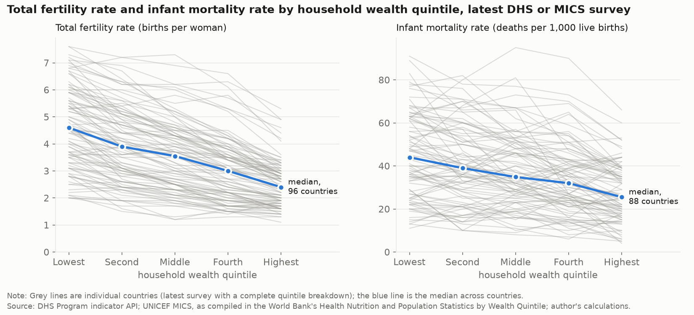
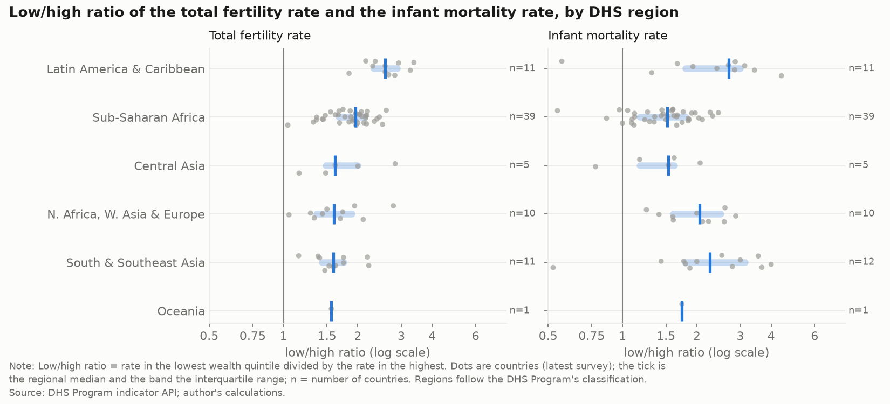
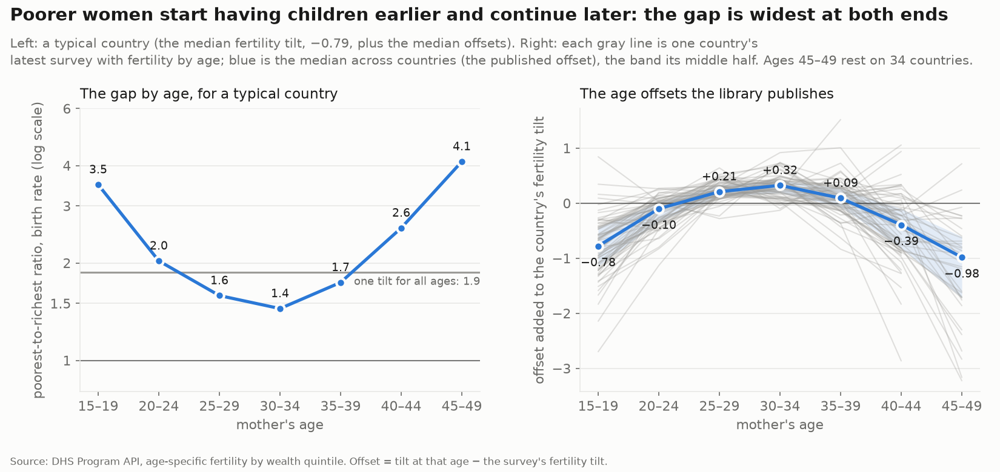
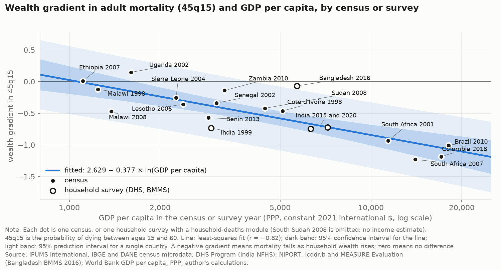

<!-- GENERATED by scripts/build_analysis.py — do not edit by hand. -->
# Findings

What the library's data show, in seven points. Each section opens with the
finding in one sentence, then the figure and the numbers behind it.

**How to read the numbers.** The library measures each pattern as a
[tilt](docs/glossary.md#tilt); the figures and tables show it as the
**[poorest-to-richest ratio](docs/glossary.md#poorest-to-richest-ratio)**. A
ratio of 2 means the poorest households have twice the rate of the richest; 1
means no difference. New
to the terms? See the [glossary](docs/glossary.md).

Coverage: 332 household surveys with complete wealth breakdowns in
78 countries (DHS), plus census death records for adult mortality.
Every number on this page is computed from the files in [`data/`](data/).

## 1. Poorer households have more births and more infant deaths, almost everywhere

**In 77 of 77 countries the poorest fifth of households has
more births than the richest; in 71 of 78 it has more infant
deaths.** The typical poorest-to-richest ratio is 1.9 for births
and 1.7 for infant deaths. That is why an economic model that gives
every income group the same demographics misses something real.

## 2. How steep, region by region

**Gradients are steepest in Latin America & Caribbean for both births and infant deaths. The mildest are in Central Asia (births) and Sub-Saharan Africa (infant deaths), but every region's median shows the poor with higher rates.** A country with no survey of its own can borrow its region's
median, using the middle half as the range to test.

**Births (fertility tilt)**

| Region | Countries | Median tilt | Middle half | Poorest-to-richest ratio |
|---|---|---|---|---|
| Latin America & Caribbean | 11 | −1.17 | −1.27 to −1.03 | 2.5 |
| Sub-Saharan Africa | 39 | −0.81 | −0.94 to −0.60 | 1.9 |
| North Africa/West Asia/Europe | 10 | −0.62 | −0.86 to −0.39 | 1.6 |
| South & Southeast Asia | 11 | −0.54 | −0.69 to −0.45 | 1.5 |
| Central Asia | 5 | −0.53 | −0.77 to −0.41 | 1.5 |
| Oceania | 1 | −0.47 | (single survey) | 1.5 |

**Infant deaths (infant-mortality tilt)**

| Region | Countries | Median tilt | Middle half | Poorest-to-richest ratio |
|---|---|---|---|---|
| Latin America & Caribbean | 11 | −1.03 | −1.37 to −0.72 | 2.3 |
| South & Southeast Asia | 12 | −0.99 | −1.35 to −0.72 | 2.2 |
| North Africa/West Asia/Europe | 10 | −0.75 | −1.06 to −0.55 | 1.8 |
| Oceania | 1 | −0.72 | (single survey) | 1.8 |
| Central Asia | 5 | −0.55 | −0.90 to −0.17 | 1.6 |
| Sub-Saharan Africa | 39 | −0.49 | −0.65 to −0.22 | 1.5 |

Under-5 deaths, for surveys with no infant figure

| Region | Countries | Median tilt | Middle half | Poorest-to-richest ratio |
|---|---|---|---|---|
| Latin America & Caribbean | 11 | −1.26 | −1.46 to −0.91 | 2.7 |
| South & Southeast Asia | 12 | −1.06 | −1.48 to −0.82 | 2.3 |
| North Africa/West Asia/Europe | 10 | −0.85 | −1.25 to −0.76 | 2.0 |
| Oceania | 1 | −0.84 | (single survey) | 2.0 |
| Sub-Saharan Africa | 39 | −0.70 | −0.93 to −0.37 | 1.8 |
| Central Asia | 5 | −0.37 | −0.52 to −0.25 | 1.3 |

## 3. The typical gradient has changed little since 1990, but a single country can

**Across all surveys the typical poorest-to-richest ratio moved only from
2.1 to 1.9 for births and from 1.8 to 1.7 for infant
deaths between the 1990s and the surveys since 2015.** A borrowed gradient is
therefore not a quantity that decays. Within one fast-developing country it
can still move a lot (Brazil, below).

### Brazil: a child-mortality gradient that halved in twenty years

Brazil's only usable survey is from 1996, so the library also measures child
mortality from three censuses, using the share of children ever born who have
died (mothers aged 25–29; [file](data/census_child_mortality.csv)). Its levels
are not comparable with survey rates, but its tilt is: the 2000 census gives
−1.45 where the Brazil 1996 DHS survey gives −1.46.

| Census | Wealth groups | Tilt | Poorest-to-richest ratio | Poorest group's children who died |
|---|---|---|---|---|
| 1991 | 4 | −1.76 | 4.1 | 10.6% |
| 2000 | 4 | −1.45 | 3.2 | 6.2% |
| 2010 | 5 | −0.84 | 2.0 | 2.4% |

The tilt went from −1.76 in 1991 to −0.84 in
2010. Child mortality fell for everyone, but fastest among the poor. The
change is not an artefact of the asset index getting richer: re-estimated on
only the five assets every census asks about, the flattening is larger
(1.06 against 0.91). A present-day Brazil
calibration should use the census value, not the 1996 survey.

## 4. The fertility gap is mostly about timing

**Poorer women start having children earlier and continue later; in the prime
childbearing ages the gap is much smaller.** For the median country the
poorest-to-richest ratio in birth rates is 3.5 at ages 15–19 and
1.4 at 30–34. One
fertility tilt at every age gets the number of children right but erases the
timing, so the library publishes **age offsets** to add to a country's tilt.
They are pooled across countries because a country's own age pattern turns out
to be mostly survey noise ([method and checks](docs/methods/fertility-by-age.md)).

## 5. Use infant deaths, not under-5 deaths, for `infmort_gradient`

**The under-5 gradient is steeper than the infant one in
84% of the 291 surveys that report both, by a
median 0.14 on the tilt.** Deaths at ages 1–4 are
dominated by diarrhoea, malaria and malnutrition, which wealth protects
against strongly; infant deaths lean toward prematurity and birth
complications, which it protects against less. The gap reaches
0.67 (Nigeria 2018). The library
measures infant mortality directly; use under-5 only where no infant figure
exists.

## 6. Adult deaths are more concentrated among the poor in richer countries

**Across 18 censuses, the adult-mortality gradient steepens with national
income (r = −0.88).** At $500 per person the
poorest-to-richest ratio in the risk of dying between 15 and 60 is about
1.2; at $5,000, about 1.9. In the
poorest countries survival differs little by wealth. That relationship is the
**general gradient**, the library's rule for countries with no census
measurement of their own ([method](docs/methods/general-gradient.md)). It also
means a model running decades forward should let the gradient steepen as the
country gets richer.

Adult mortality cannot come from household surveys (the people who died are
not there to interview), so it comes from censuses that record deaths in each
household over the past year ([method](docs/methods/adult-mortality.md)).
Every census measurement is in the [full table](docs/tables/adult_mortality.md).

## 7. The adult gradient weakens with age, and in the poorest countries reverses

**In 12 of the 12 censuses measured at more than one
age, the gradient is weaker at the oldest ages than at 15–29; in
6 the richer households report more deaths at the oldest
ages.** Part of this is real (where everyone is poor, survival differs little)
and part is how deaths are reported (frail elderly relatives often move into
better-off households before they die). No check within a census separates the
two, so the older-age values are the least certain in the library.

