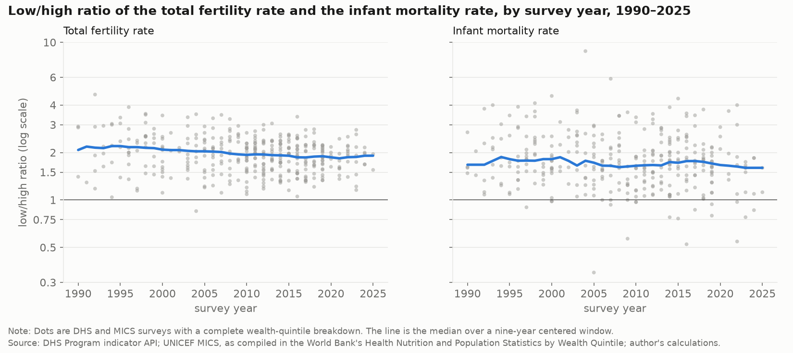
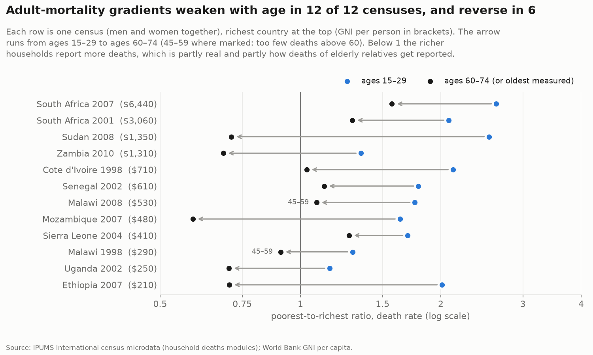

<!-- GENERATED by scripts/build_analysis.py — do not edit by hand. -->
# Main results

Wealth differentials in fertility and mortality, summarized from the library's
data. Differentials are reported as the **low/high ratio**, the rate in the
lowest wealth quintile divided by the rate in the highest, and as the
**wealth gradient**, the slope of the log rate on wealth rank (see the
[glossary](docs/glossary.md)). The data cover 332 Demographic and Health
Surveys (DHS) and 77 Multiple Indicator Cluster Surveys (MICS) with a
complete wealth-quintile breakdown in 97 countries, and, for adult
mortality, household-death records from censuses and household surveys. All figures and numbers are
computed from the files in [`data/`](data/).

## Fertility and infant mortality by wealth quintile

In the latest survey for each country, the total fertility rate is higher in
the lowest quintile than in the highest in 96 of 96 countries,
and the infant mortality rate in 80 of 88. The median low/high
ratio is 1.88 for the total fertility rate and 1.66 for
the infant mortality rate.

## Regional medians

Among regions with at least three countries, the median low/high ratio is highest in Latin America & Caribbean for fertility and in South & Southeast Asia for infant mortality, and lowest in Central Asia for both indicators. For a
country without a survey, the regional median gradient can be used, with the
interquartile range as a sensitivity range.

**Total fertility rate**

| Region | Countries | Median gradient | Interquartile range | Median low/high ratio |
|---|---|---|---|---|
| Latin America & Caribbean | 16 | −1.11 | −1.22 to −0.87 | 2.46 |
| Sub-Saharan Africa | 40 | −0.83 | −0.94 to −0.64 | 1.96 |
| Oceania | 4 | −0.61 | −0.67 to −0.54 | 1.62 |
| North Africa/West Asia/Europe | 15 | −0.57 | −0.74 to −0.43 | 1.54 |
| South & Southeast Asia | 15 | −0.54 | −0.69 to −0.50 | 1.59 |
| Central Asia | 6 | −0.46 | −0.71 to −0.30 | 1.50 |

**Infant mortality rate**

| Region | Countries | Median gradient | Interquartile range | Median low/high ratio |
|---|---|---|---|---|
| South & Southeast Asia | 13 | −1.14 | −1.39 to −0.73 | 2.53 |
| Latin America & Caribbean | 13 | −0.98 | −1.37 to −0.60 | 2.41 |
| Oceania | 3 | −0.72 | −0.79 to −0.63 | 1.91 |
| North Africa/West Asia/Europe | 12 | −0.63 | −0.92 to −0.53 | 1.90 |
| Central Asia | 6 | −0.51 | −0.70 to −0.25 | 1.49 |
| Sub-Saharan Africa | 41 | −0.49 | −0.66 to −0.23 | 1.60 |

Under-five mortality rate (for comparison)

| Region | Countries | Median gradient | Interquartile range | Median low/high ratio |
|---|---|---|---|---|
| South & Southeast Asia | 13 | −1.18 | −1.47 to −0.82 | 2.64 |
| Latin America & Caribbean | 13 | −1.17 | −1.46 to −0.74 | 2.80 |
| Oceania | 3 | −0.84 | −1.01 to −0.72 | 2.08 |
| North Africa/West Asia/Europe | 12 | −0.81 | −1.03 to −0.66 | 2.11 |
| Sub-Saharan Africa | 41 | −0.70 | −0.93 to −0.31 | 1.80 |
| Central Asia | 6 | −0.41 | −0.72 to −0.26 | 1.51 |

## Changes over time

Across all surveys, the median low/high ratio of the total fertility rate was
2.21 in surveys before 2000 and 1.90 in surveys from 2015; for the
infant mortality rate it was 1.80 and 1.67. The change in the pooled
differential is small relative to the variation between countries. Individual
countries can change considerably, as the Brazilian census series below
shows.

### Child mortality in Brazil, 1991–2010

Brazil's most recent DHS survey is from 1996. Child mortality by wealth is
therefore also estimated from the 1991, 2000 and 2010 censuses, using the
proportion of children ever born who have died among mothers aged 25–29
([`census_child_mortality.csv`](data/census_child_mortality.csv)). The levels
are not comparable with survey mortality rates, but the gradients are: the
2000 census gives −1.40, against −1.46 for the
under-five mortality rate in the Brazil 1996 DHS survey.

| Census | Wealth groups | Gradient | Low/high ratio | Lowest group, children who died (%) |
|---|---|---|---|---|
| 1991 | 4 | −1.81 | 4.16 | 9.9 |
| 2000 | 4 | −1.40 | 3.01 | 5.8 |
| 2010 | 5 | −0.96 | 2.26 | 2.5 |

The gradient changed from −1.81 in 1991 to −0.96 in
2010: child mortality fell in all groups, and most in the poorest. On an
index restricted to the 5 assets recorded in all three censuses,
the 1991–2000 change is 0.46, compared with 0.41 on the
full index, so the change does not stem from the larger asset set of later
censuses. In 2010 the restricted index separates fewer than three groups, so
no 2010 value is published on it. For Brazil, the census estimate is used in
preference to the 1996 survey.

## Fertility by age of mother

The differential varies with age. The median low/high ratio of the
age-specific fertility rate is 3.72 at ages 15–19, 1.39 at
30–34 and 5.00 at 45–49, against 1.88 for the total
fertility rate: fertility in poorer households is higher mainly at younger and
older ages. A single gradient applied at all ages reproduces the differential
in completed fertility but not in the timing of births. The library publishes
age offsets to add to a country's TFR gradient; they are pooled across
countries because country-specific age patterns are no more accurate overall
and cannot be estimated at older ages in many surveys
([details](docs/methods/fertility-by-age.md)).

## Infant and under-five mortality

In the 339 surveys that report both by wealth quintile, the gradient in
under-five mortality is steeper than the gradient in infant mortality in
84% of cases, by a median of 0.14; the
largest difference is 0.67 (Nigeria 2018).
This is consistent with the larger share of infectious causes in deaths at
ages 1–4, which are more closely associated with living conditions than the
neonatal causes that dominate infant mortality. `infmort_gradient` therefore
uses the infant mortality rate; the under-five rate is published for
comparison.

## Adult mortality and national income

Adult mortality by wealth requires deaths recorded against the deceased's own
household. The library uses censuses that record deaths of household members
during a recent period, usually the previous year, and, for India and
Bangladesh, household surveys that record them for the previous two years
([methods](docs/methods/adult-mortality.md); [all estimates](docs/tables/adult_mortality.md)).
Across the 19 censuses and surveys with an income estimate, the gradient in
45q15 is steeper in richer countries (r = −0.75): the fitted
gradient is −0.32 at a GDP per capita (PPP, constant 2021
international $) of $2,000 and
−1.01 at $10,000. This relationship, the general gradient,
provides values for countries without their own estimate
([details](docs/methods/general-gradient.md)). Within countries the evidence
is limited and mixed: South Africa's gradient steepened between its 2001 and
2007 censuses, while India's changed little between 1999 and 2020 as its income
per capita rose by a factor of 2.4.

## Adult mortality by age

In all 14 censuses and surveys with estimates at ages 15–29
and at least one older band, the gradient is weaker at the oldest band measured
than at ages 15–29. In 4 censuses, all with GDP per capita (PPP) of
$4,446 or less, it is positive at the oldest band: recorded
death rates rise with household wealth. Two explanations are consistent with
this: small survival differences where most households are poor, and elderly
people in poor health moving into better-off households before death. The
data do not distinguish between them, and the older-age estimates are
the least certain in the library.

