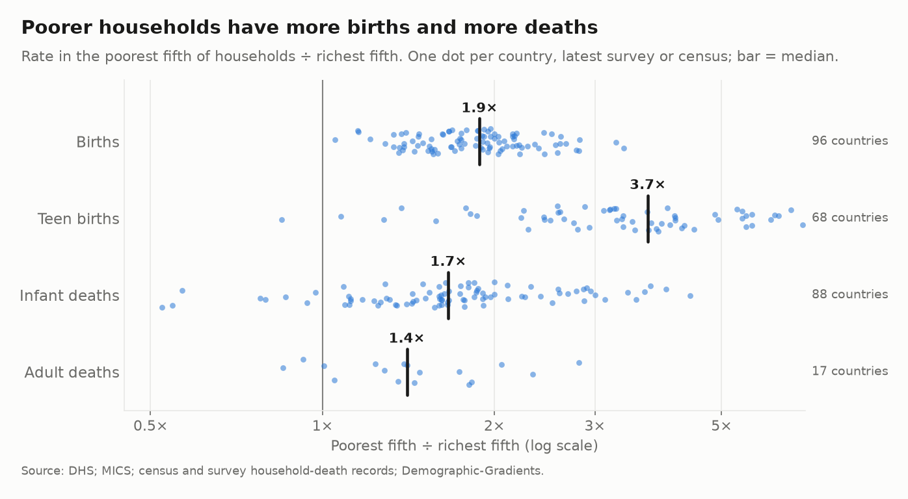

# Demographic-Gradients

How much births and deaths differ between poorer and richer households in low-
and middle-income countries, measured from household surveys and censuses. The
values are for [OG-Core](https://github.com/PSLmodels/OG-Core) models in which
these rates differ by income.

Each country's difference is summarised by one number, its **wealth gradient**,
which is the value the model takes:

## Coverage

<!-- AUTO-GENERATED by scripts/build_analysis.py — do not edit by hand -->
| Rate | OG-Core input | Source | Countries | Typical gap, poorest ÷ richest |
|---|---|---|---|---|
| Births, by age of mother | `fert_gradient` | DHS, MICS | 96 | 1.9× (all ages); 3.7× at ages 15–19 |
| Infant deaths | `infmort_gradient` | DHS, MICS | 88 | 1.7× |
| Adult deaths, ages 15–59 | `mort_gradient` | deaths recorded by households (censuses; surveys in India and Bangladesh) | 17; others predicted from national income | 1.5× |
| Income of immigrants | `imm_pctiles` | not provided | — | — |
<!-- END AUTO-GENERATED -->

Births and child deaths: 409 surveys, 97 countries (DHS API pull of 16 November 2026; MICS values
from the World Bank's compilation, last updated December 2022). With adult
deaths, 98 countries in all. High-income countries are outside the scope.

## Use in an OG-Core model

1. Open your country's page in [docs/countries/](docs/countries/README.md). It
   lists every value.
2. Use the country's own estimate. Where there is none, the page gives the
   substitute and says whether it is borrowed or predicted.
3. Convert each value to OG-Core's units and pass it by age.

The [calibration guide](docs/calibration-guide.md) explains each step and ends
with a [worked example in Python](docs/calibration-guide.md#worked-example-south-africa).

## Documentation

| | |
|---|---|
| [Calibration guide](docs/calibration-guide.md) | How to use the values in an OG-Core model, with a worked example |
| [Main results](docs/results.md) | Summary of the estimates, with figures and regional medians |
| [Adult mortality: all estimates](docs/tables/adult_mortality.md) | Every census and survey estimate, by sex and age band |
| Methods | [Survey estimates](docs/methods/survey-gradients.md) · [Fertility by age](docs/methods/fertility-by-age.md) · [Adult mortality](docs/methods/adult-mortality.md) · [General gradient](docs/methods/general-gradient.md) · [Conversion to OG-Core units](docs/methods/ogcore-units.md) |
| [Sources and limitations](docs/sources.md) | Data sources, citation and limitations |
| [Glossary](docs/glossary.md) | Definitions of terms and abbreviations |
| [Files](docs/files.md) | Data files, scripts and figures, and how to rebuild them |

## Licence and citation

Data and code are public domain ([CC0 1.0](LICENSE)). Please cite this
repository together with the underlying sources: the DHS Program and UNICEF
(MICS), and IPUMS International with the national statistical office for census
estimates ([details](docs/sources.md#citation)).

## Maintenance

`uv run scripts/refresh.py` rebuilds the data, figures and generated pages.
Generated pages are changed through the scripts ([AGENTS.md](AGENTS.md#working-on-this-repo)).
[CHANGELOG.md](CHANGELOG.md) records changes to published values;
[ROADMAP.md](ROADMAP.md) lists open work.
