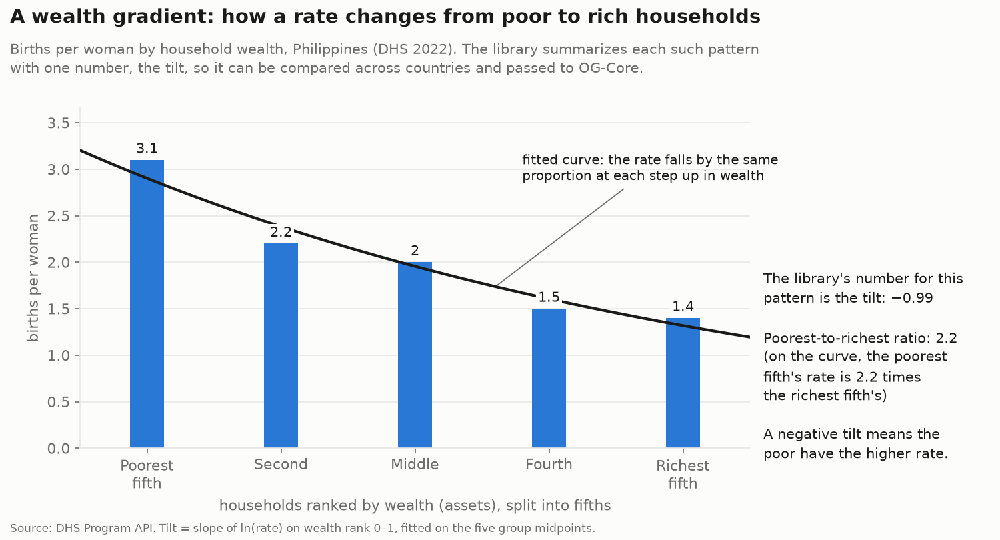

# Demographic-Gradients

Rich and poor households have different birth and death rates. This library
measures **how different**, country by country, so that economic models can
give each income group its own demographics instead of assuming everyone is
average.

It was built for the [OG-Core](https://github.com/PSLmodels/OG-Core) family of
country models (OG-ZAF, OG-PHL, OG-IDN, OG-ETH, OG-BRA, ...), whose population
module can vary fertility and mortality by lifetime income. The numbers are
open data, so anyone can use them.



## What it covers

<!-- AUTO-GENERATED by scripts/build_analysis.py — do not edit by hand -->
| What it measures | OG-Core input | Source | Countries | Typical poorest-to-richest ratio |
|---|---|---|---|---|
| Births, by mother's age | `fert_gradient` | household surveys (DHS) | 77 | 1.9 overall; 3.5 for teenagers |
| Infant deaths | `infmort_gradient` | household surveys (DHS) | 78 | 1.7 |
| Adult deaths, ages 15–60 | `mort_gradient` | census death records | 15 measured; any country via the general gradient | 1.3, steeper in richer countries |
| Income of new immigrants | `imm_pctiles` | not covered | — | — |
<!-- END AUTO-GENERATED -->

*(332 surveys, 78 countries; DHS API pull of 11 November 2026.)* The library
covers developing countries by design: every source it uses is a low- and
middle-income instrument.

## Find your country

**[docs/countries/](docs/countries/)** has one page per country. Each starts
with the values to give OG-Core, then shows where every number comes from.

## Use it in an OG-Core calibration

Each value in the library is a **tilt**, one number per country and measure.
Three steps turn it into what OG-Core reads:

1. **Pick the tilt.** Take the country's own measurement. With none, use the
   general gradient for adult mortality, or the regional median for births and
   infant deaths, and say that you borrowed it.
2. **Spread fertility by age.** Add the [age offsets](docs/methods/fertility-by-age.md)
   to the fertility tilt.
3. **Convert:** `tilt / (100 × (1 − p))`, where p is OG-Core's own rate at
   that age ([why](docs/methods/ogcore-units.md)).

```python
import numpy as np
import pandas as pd
from ogcore import demographics

BASE = "https://raw.githubusercontent.com/EAPD-DRB/Demographic-Gradients/main/data/"
lib = pd.read_csv(BASE + "gradient_library_latest.csv")
off = pd.read_csv(BASE + "fertility_age_offsets.csv").set_index("age_lo")["offset"]

country, un_code = "South Africa", "710"
tilt = lib.query("country == @country and indicator == 'TFR'")["slope"].iloc[0]

ages = np.arange(p.E + p.S)   # p: your OG-Core Specifications; ages 0-99
tilt_by_age = tilt + off.loc[np.clip(ages // 5 * 5, 15, 45)].values
fert = demographics.get_fert(p.E + p.S, 0, 99, country_id=un_code)
fert_gradient = tilt_by_age / (100 * (1 - fert[0]))

pop = demographics.get_pop_objs(p.E, p.S, p.T, 0, 99, country_id=un_code,
                                income_percentiles=list(p.lambdas),
                                fert_gradient=fert_gradient)
```

The precise rules, including the traps that have already caused errors, are in
**[AGENTS.md](AGENTS.md)**. It is written so that an AI assistant can apply it
too.

## Learn more

| | |
|---|---|
| [Findings](ANALYSIS.md) | What the data show, in seven points with figures |
| [Glossary](docs/glossary.md) | Every term and abbreviation used here |
| [Data files](docs/data-files.md) | What each file in `data/` holds, column by column |
| Methods | [Survey gradients](docs/methods/dhs-gradients.md) · [Fertility by age](docs/methods/fertility-by-age.md) · [Adult mortality](docs/methods/adult-mortality.md) · [General gradient](docs/methods/general-gradient.md) · [Passing a tilt to OG-Core](docs/methods/ogcore-units.md) |
| [Sources, citation and limits](docs/sources.md) | Where the data come from, how to cite them, and what they cannot tell you |

## Citing

Cite this repository and the underlying sources: **The DHS Program** for births
and infant deaths, and **IPUMS International** (Ruggles et al.,
doi:10.18128/D020.V7.7) plus the national statistical office for census-based
adult mortality ([details](docs/sources.md)).

## For maintainers

Everything is rebuilt from free public sources by `uv run scripts/refresh.py`.
The documentation pages marked *generated* are written by the scripts, so edit
the scripts rather than the pages. [AGENTS.md → Working on this
repo](AGENTS.md#working-on-this-repo) has the rules. [ROADMAP.md](ROADMAP.md)
tracks open work, and `research/` holds working notes from the original build.
