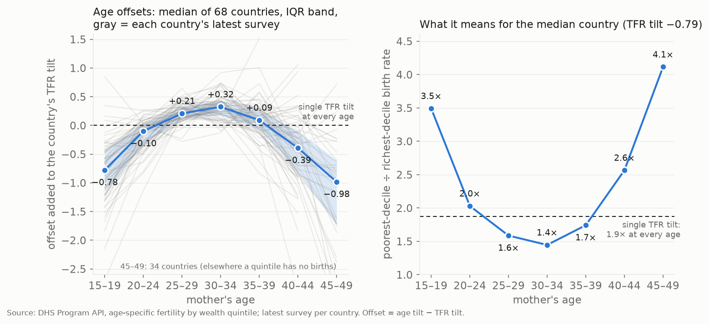

<!-- GENERATED by scripts/build_analysis.py — do not edit by hand. -->
# Fertility by age

The fertility gradient is mostly about **when** women have children, not only
how many. Poorer women start earlier and continue later; births in the prime
childbearing ages differ much less by wealth. A single TFR tilt applied at
every age (the simplest use of `fert_gradient`) keeps the gap in the number
of children but erases the gap in timing.

The library therefore publishes **age offsets**: how much steeper or flatter
the tilt is at each age than the country's TFR tilt, pooled across countries.

    fertility tilt at age a = country's TFR tilt + offset(a)



## The offsets

From [`data/fertility_age_offsets.csv`](../../data/fertility_age_offsets.csv):
the median across countries' latest surveys of (age tilt − TFR tilt). The last
two columns apply them to the median country (TFR tilt −0.79).

| Ages | Offset | IQR | Countries | Median country's tilt | Poorest ÷ richest decile |
|---|---|---|---|---|---|
| 15–19 | **−0.78** | −1.14 to −0.44 | 68 | −1.56 | 3.5× |
| 20–24 | **−0.10** | −0.33 to 0.02 | 68 | −0.88 | 2.0× |
| 25–29 | **0.21** | 0.13 to 0.33 | 68 | −0.58 | 1.6× |
| 30–34 | **0.32** | 0.19 to 0.42 | 68 | −0.46 | 1.4× |
| 35–39 | **0.09** | −0.07 to 0.27 | 68 | −0.69 | 1.7× |
| 40–44 | **−0.39** | −0.82 to −0.10 | 66 | −1.18 | 2.6× |
| 45–49 | **−0.98** | −1.72 to −0.61 | 34 | −1.77 | 4.1× |

A single TFR tilt would put the poorest decile at
1.9× the richest at every age. At 45–49
only 34 countries can be fitted: elsewhere a quintile reports no
births. Rates there are small, so the offset matters little.

## Why pooled offsets, not each country's own age tilts

The per-survey age tilts are in
[`data/fertility_age_tilts.csv`](../../data/fertility_age_tilts.csv), but a
country's own age shape is mostly survey noise. The test: predict each
survey's age shape (age tilt − TFR tilt) from three candidates, over
172 pairs of consecutive surveys in the same
country. Mean absolute error:

| Ages | Single TFR tilt | Pooled offsets (other countries) | Same country's previous survey |
|---|---|---|---|
| 15–19 | 0.76 | 0.45 | 0.37 |
| 20–24 | 0.21 | 0.21 | 0.17 |
| 25–29 | 0.24 | 0.12 | 0.11 |
| 30–34 | 0.29 | 0.17 | 0.17 |
| 35–39 | 0.22 | 0.22 | 0.25 |
| 40–44 | 0.60 | 0.49 | 0.53 |
| **All** | **0.39** | **0.27** | **0.27** |

The age shape is real — the pooled offsets cut the error of a single tilt by
29% — but a country's own previous survey
predicts its next one no better than the pooled offsets, and worse at 35 and
over. The previous survey's error also includes genuine change between
surveys, so this is a generous test for the own-country route.

## Checks

- **The age rates add up.** In all 1,381 survey-quintile cells,
  5 × the sum of the age-specific rates reproduces DHS's published TFR to
  within 0.055 births per woman — the most rounding alone allows
  (TFR is published to one decimal, the age rates as whole numbers per 1,000).
- **The TFR gradient is kept.** Adding the offsets changes the gap in total
  fertility between groups very little: the offsets roughly cancel when
  weighted by how many births fall at each age.

## Recipe for a calibration

1. Take the country's TFR tilt from
   [`gradient_library_latest.csv`](../../data/gradient_library_latest.csv)
   (or the regional median if it has no survey).
2. Add the offset for each single year of age: ages under 15 take the 15–19
   offset, ages 50 and over the 45–49 offset (fertility is close to zero
   there, so this choice is immaterial).
3. Convert to OG-Core units as for any tilt:
   `tilt / (100 × (1 − p))`, with p OG-Core's own fertility rate at that age
   ([passing a tilt to OG-Core](ogcore-units.md)).

With the usual 100 model ages (E + S = 100, ages 0–99):

```python
off = pd.read_csv(".../data/fertility_age_offsets.csv").set_index("age_lo")["offset"]
ages = np.arange(p.E + p.S)
fert_tilt_by_age = fert_tilt + off.loc[np.clip(ages // 5 * 5, 15, 45)].values
fert = demographics.get_fert(p.E + p.S, 0, 99, country_id="710")
fert_gradient = fert_tilt_by_age / (100 * (1 - fert[0]))
```

Source: the DHS Program indicator API, age-specific fertility rates
(`FE_FRTR_W_A15` … `FE_FRTR_W_A45`) by wealth quintile. Cite the DHS Program.
