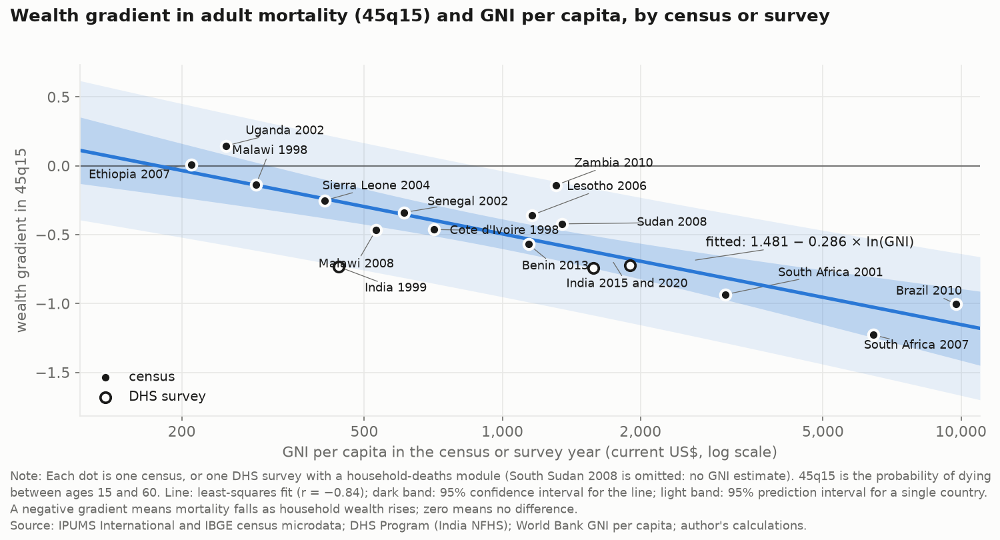

<!-- GENERATED by scripts/build_analysis.py — do not edit by hand. -->
# The general gradient: adult mortality in countries without their own estimate

Most countries have no estimate of the wealth gradient in adult mortality from
household-death records. For these countries the library provides a fallback,
the *general gradient*, in
[`data/general_gradient.csv`](../../data/general_gradient.csv). A country's own
estimate, where one exists, is always preferred.

## The income relationship

Across countries, the gradient in 45q15 (the probability of dying between ages
15 and 60) becomes steeper as national income rises. Estimated by ordinary
least squares on 17 observations, censuses and DHS surveys with a
household-deaths module, each with equal weight:

    gradient(45q15) = 1.481 − 0.286 × ln(GNI per capita, current US$)

with r = −0.84 and a residual standard error of 0.21. A doubling of
GNI per capita corresponds to a change of −0.20 in the gradient.

| | Estimate | Standard error | 95% confidence interval |
|---|---|---|---|
| Intercept | 1.481 | 0.335 | |
| Slope on ln(GNI per capita) | −0.286 | 0.048 | −0.388 to −0.184 |

Intervals use Student's t with 15 degrees of freedom. Some countries
contribute more than one observation (India 3, Malawi 2, South Africa 2); clustering the standard
error of the slope by country gives 0.044, close to the
conventional value.

The slope is estimated precisely, but a single country can lie well off the
line. For a country without its own estimate, the relevant uncertainty is the
95% prediction interval,

    prediction ± t × s × √(1 + 1/n + (ln GNI − mean ln GNI)² / Sxx)

with s the residual standard error and the remaining terms in
[`data/general_gradient.csv`](../../data/general_gradient.csv). At GNI per
capita of $1,000 the general gradient is −0.49 (95% prediction interval −0.95 to −0.04); at $5,000 it is
−0.95 (95% prediction interval −1.44 to −0.47). The leave-one-out prediction errors reported below are of
the same order. The observations, their GNI and the leave-one-out
predictions are in
[`data/general_gradient_points.csv`](../../data/general_gradient_points.csv);
GNI per capita (World Bank, Atlas method, current US$, as retrieved on the date
recorded) is in [`data/gni_census_years.csv`](../../data/gni_census_years.csv).

## Choice of rule

Three candidate rules were compared by leave-one-country-out prediction: each
observation is predicted from a rule estimated without any observation of the
same country, which matches the use case of a country with no estimate of its
own. All three are scored on the same observations; the regional rule uses UN
subregions and falls back to the pooled median where no other country in the
subregion is available.

| Candidate rule | Mean absolute error |
|---|---|
| A single value for all countries (pooled median) | 0.311 |
| **Linear in ln(GNI per capita)** | **0.176** |
| Regional median | 0.331 |

The income rule has the lowest error, and is used. For South Africa 2007 the out-of-sample prediction is −0.92 against a measured −1.23. Where no GNI figure is available, the pooled
median of all estimates, −0.44, is used.

## Age pattern

`mort_gradient` accepts a gradient by age. The general gradient is spread across
age bands by adding pooled offsets, estimated as the median difference between
each estimate's band gradient and its 45q15 gradient:

| Age band | Offset | |
|---|---|---|
| 15–29 | −0.47 |  |
| 30–44 | −0.27 |  |
| 45–59 | 0.13 | least reliable |
| 60–74 | 0.43 | least reliable |

Applied to the estimates' own 45q15 gradients, the offsets reproduce the
measured band gradients with a median absolute error of 0.12. The
offsets for ages 45–59 and 60–74 are the least reliable values in the library:
they are positive because, in several low-income censuses, recorded mortality
at older ages rises with household wealth (see below). Where working-age
mortality is what matters, the 15–29 and 30–44 offsets are the more reliable.

## Use over long horizons

Across countries the gradient is steeper at higher income, which implies that
it steepens as a country's income rises. The evidence within countries is
limited and mixed. Between Malawi's 1998 and 2008 censuses the 45q15 gradient
moved from −0.14 to −0.47 as GNI per capita rose from about $290 to
$530 (the 1998 wealth ranking rests on only three asset variables; see the
[Malawi page](../countries/malawi.md)). India's three surveys do not show it within a country: the gradient was −0.73, −0.74, −0.72 in 1999, 2015 and 2020, while GNI per capita rose from about $440 to $1,900; the 1999 survey lies well off the cross-country line. A model projecting a country
over several decades can hold the gradient fixed or let it follow the income
relationship; the two bracket the evidence.

## Scope

The rule is estimated on observations with GNI per capita between about $200
and $10,000 and should not be extrapolated beyond that range. Of the
17 observations, 13 are African censuses, one is a Brazilian
census and 3 are Indian surveys. There is no estimate for East or
Southeast Asia, so predictions for the Philippines or Indonesia rest on a
relationship estimated largely outside their region.

## Older-age reversals

At the oldest ages measured, recorded mortality is higher in wealthier
households in Ethiopia 2007, Sudan 2008, Uganda 2002 and Zambia 2010. Two explanations are consistent with this. Where
most households are poor, survival may differ little by wealth, and causes of
death are less socially graded than in middle-income countries. Alternatively,
elderly people in poor health often move into better-off households before
death, so the death is recorded against that household's wealth.

Evidence from DHS sibling histories suggests that reporting contributes. In
those data, poorer and less educated respondents report fewer siblings than
wealthier respondents despite higher fertility, and the shortfall increases
with recall period; under-reporting of deaths by poorer households flattens or
reverses a measured gradient in the same way. The household-death data alone cannot
distinguish the two explanations, which is why the older-age offsets carry a
caution.

HIV does not appear to drive the pattern: Lesotho, the highest-prevalence
country in the set, has a 45q15 gradient of −0.36, and
most reversals occur in the oldest age bands, where HIV mortality is
comparatively low.
